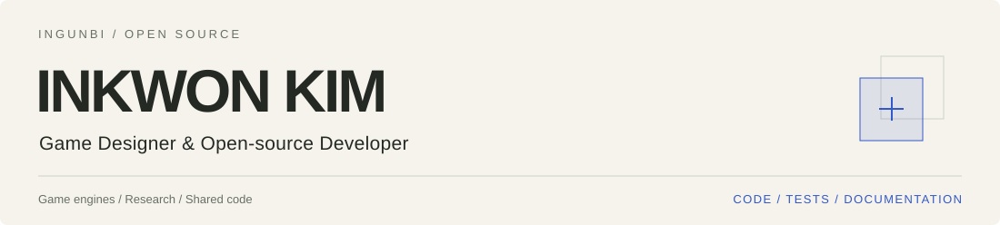

<picture>
  <source media="(prefers-color-scheme: dark)" srcset="assets/open-source-dark.svg">
  
</picture>

**게임디자이너이자 오픈소스 개발자, 김인권**입니다.

게임의 규칙을 설계하고, 그 규칙이 작동하는 엔진과 도구를 코드로 만듭니다.
이곳에는 직접 구현한 코드와 연구 과정, 테스트와 개발 문서를 공개합니다.
2006년부터 게임을 개발하며 웹젠의 **C9**, IMC게임즈의 **트리 오브 세이비어** 개발에 참여했고,
현재는 **아이스큐브랩 대표·PD**로 개발과 게임·XR 교육을 이어가고 있습니다.

[공개 저장소](https://github.com/ingunbi?tab=repositories&type=public) · [개발 로그](https://kiminkwon.com/dev_log/) · [개발 경력·포트폴리오](https://kiminkwon.com/dev/) · [작가 홈페이지](https://kiminkwon.com/)

## Open source

### [영걸전 자체 엔진](https://github.com/ingunbi/yeonggeoljeon-engine)

**Swift · AppKit · Python · GPL-3.0-only**

DOS판 삼국지 영걸전의 자료 형식과 실행 동작을 연구하며 만드는 자체 SRPG 엔진입니다.
자료 해독부터 전투 규칙·AI·캠페인 실행기까지 연결하고, 구현 근거와 검사 방법을 코드와 함께 공개합니다.

- **코드와 근거** — 엔진 구현, 자료 해석 도구, 형식·규칙 연구 문서
- **검증** — 원작 자료 없이 실행하는 합성 테스트와 선택적인 실물 검사 구분
- **개발 과정** — 백로그·구현 범위·남은 한계와 기여 안내 공개

연구 개발판이며 전체 캠페인의 사람에 의한 완주 검증은 아직 없습니다.
공개 범위는 새 엔진 코드·문서·합성 테스트로, 원작 게임 자료나 이를 포함한 앱은 배포하지 않습니다.

[소스](https://github.com/ingunbi/yeonggeoljeon-engine) · [개발 계획](https://github.com/ingunbi/yeonggeoljeon-engine/blob/main/BACKLOG.md) · [연구 문서](https://github.com/ingunbi/yeonggeoljeon-engine/blob/main/research/README.md) · [기여 안내](https://github.com/ingunbi/yeonggeoljeon-engine/blob/main/CONTRIBUTING.md)

### [Unity 클리커 학습 예제](https://github.com/ingunbi/Unity_ClickerGame_Tutorial)

**Unity · C# · 공개 교육 자료**

클릭 보상, 강화, 자동 수익과 로컬 저장을 연결한 작은 게임 루프입니다.
게임 상태 관리와 UI, 코루틴의 관계를 코드로 살펴볼 수 있습니다.

## Selected work

### C9 · Continent of the Ninth

**웹젠 · 구 NHN게임스 | 2008.02 – 2012.02 | Action RPG**

게임 엔진 최적화와 주요 콘텐츠 시스템 개발에 참여했습니다.
참여 작품 C9은 **2009 대한민국 게임대상 대상 포함 5개 부문**을 수상했습니다.

### 트리 오브 세이비어 · Tree of Savior

**IMC게임즈 | 2012.02 – 2013.03 | MMORPG**

캐릭터·전투 시스템 로직 구현과 최적화에 참여했습니다.
참여 작품 트리 오브 세이비어는 **2016 대한민국 게임대상 기술창작상 기획·캐릭터 부문**을 수상했습니다.

참여 기간과 담당 업무는 [개발 경력](https://kiminkwon.com/dev/)에 정리했습니다. 수상 연도는 작품의 수상 시점입니다.

## Game development

- **2006.07 – 2007.10 · 마이게임투조이 EX 개발팀** — 게임 시스템 설계·프로그래밍·UI.
- **2013.11 – 현재 · 아이스큐브랩 대표·PD** — 게임 개발 총괄, XR 콘텐츠 기획, 교육 콘텐츠 제작.

## Teaching & mentoring

게임 개발 경험을 바탕으로 대학·부트캠프·기업에서 게임 엔진과 XR 제작을 가르치고, 팀 프로젝트의 기획·구현·코드리뷰를 지도합니다.

- **Unreal Authorized Instructor** · Epic Games (2024.04)
- **Unity Certified Instructor** · Unity Technologies (2023.11)
- Unreal Engine·Unity·게임 기획 교육, 프로젝트 피드백과 개발 과정 지도

[교육 경력 전체](https://kiminkwon.com/dev/) · [Unity 클리커 학습 예제](https://github.com/ingunbi/Unity_ClickerGame_Tutorial)

## Tools & practice

**Unreal Engine · Unity · Swift · Python · TypeScript / JavaScript**

게임 시스템과 플레이 흐름 설계, 프로토타입 제작, 엔진·콘텐츠 제작 도구 개발을 함께 다룹니다.
코드와 생성형 AI를 활용한 인터랙티브 작업은 [작가 홈페이지](https://kiminkwon.com/)에서 소개합니다.
