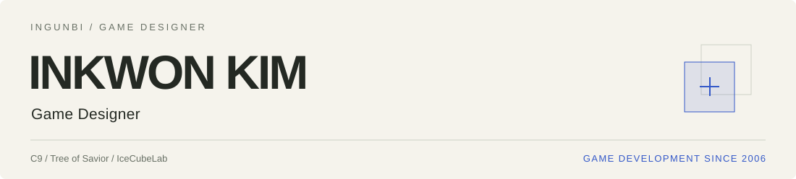

<picture>
  <source media="(prefers-color-scheme: dark)" srcset="assets/game-designer-dark.svg">
  
</picture>

**게임디자이너 김인권**입니다.

2006년 게임 개발을 시작해 **웹젠의 C9**, **IMC게임즈의 트리 오브 세이비어** 개발에 참여했습니다.
게임 시스템 설계와 프로그래밍을 바탕으로, 기획한 규칙이 실제 플레이에서 어떻게 작동하는지 다룹니다.
현재는 **아이스큐브랩 대표·PD**로 게임·XR 콘텐츠를 기획하고, Unreal Engine·Unity 교육과 개인 게임 개발·연구를 이어가고 있습니다.

[개발 경력·포트폴리오](https://kiminkwon.com/dev/) · [개발 로그](https://kiminkwon.com/dev_log/) · [작가 홈페이지](https://kiminkwon.com/) · [IceCubeLab](https://www.icecubelab.com/)

## Selected work

### C9 · Continent of the Ninth

**웹젠 · 구 NHN게임스 | 2008.02 – 2012.02 | Action RPG**

게임 엔진 최적화와 주요 콘텐츠 시스템 개발에 참여했습니다.
참여 작품 C9은 **2009 대한민국 게임대상 대상 포함 5개 부문**을 수상했습니다.

### 트리 오브 세이비어 · Tree of Savior

**IMC게임즈 | 2012.02 – 2013.03 | MMORPG**

캐릭터·전투 시스템 로직 구현과 최적화에 참여했습니다.
참여 작품 트리 오브 세이비어는 **2016 대한민국 게임대상 기술창작상 기획·캐릭터 부문**을 수상했습니다.

참여 기간과 담당 업무는 [개발 경력](https://kiminkwon.com/dev/)에 정리했습니다. 수상 연도는 작품의 수상 시점입니다.

## Game development

- **2006.07 – 2007.10 · 마이게임투조이 EX 개발팀** — 게임 시스템 설계·프로그래밍·UI.
- **2013.11 – 현재 · 아이스큐브랩 대표·PD** — 게임 개발 총괄, XR 콘텐츠 기획, 교육 콘텐츠 제작.

### 영걸전 자체 엔진 · 개인 연구

DOS판 삼국지 영걸전의 자료와 실행 동작을 분석하며 **Swift 기반 SRPG 엔진**을 개발하고 있습니다.
자료 해독, 전투 규칙과 AI, 캠페인 실행기를 연결하는 연구 개발판입니다.
공개 저장소에는 새 엔진 코드·문서·합성 테스트를 담고 있으며, 원작 게임 자료는 포함하지 않습니다.

[엔진 소스·개발 문서](https://github.com/ingunbi/yeonggeoljeon-engine) · [최근 작업 기록](https://kiminkwon.com/dev_log/)

## Teaching & mentoring

게임 개발 경험을 바탕으로 대학·부트캠프·기업에서 게임 엔진과 XR 제작을 가르치고, 팀 프로젝트의 기획·구현·코드리뷰를 지도합니다.

- **Unreal Authorized Instructor** · Epic Games (2024.04)
- **Unity Certified Instructor** · Unity Technologies (2023.11)
- Unreal Engine·Unity·게임 기획 교육, 프로젝트 피드백과 개발 과정 지도

[교육 경력 전체](https://kiminkwon.com/dev/) · [Unity 클리커 학습 예제](https://github.com/ingunbi/Unity_ClickerGame_Tutorial)

## Tools & practice

**Unreal Engine · Unity · Swift · Python · TypeScript / JavaScript**

게임 시스템과 플레이 흐름 설계, 프로토타입 제작, 엔진·콘텐츠 제작 도구 개발을 함께 다룹니다.
코드와 생성형 AI를 활용한 인터랙티브 작업은 [작가 홈페이지](https://kiminkwon.com/)에서 소개합니다.
